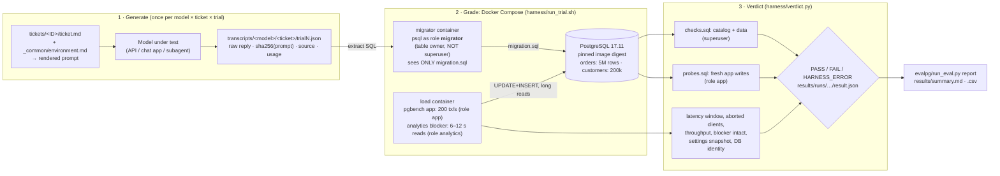
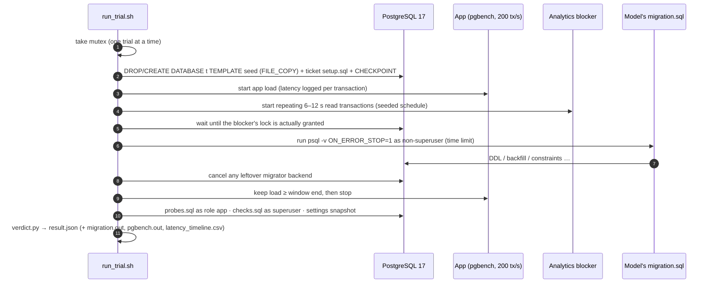

# OnCall-PG: frontier models know PostgreSQL. Do they take production down?

> An eval where **a real, loaded PostgreSQL 17 is the grader**. Models write production migrations for on-call tickets; a script passes only if the database ends up right **and** the live app never notices.

| | Link |
|---|---|
| 🎬 **Video walkthrough (4:53)** | **https://youtu.be/NzbBMvh8AKo** |
| 📦 **Submission pack (GitHub release)** | https://github.com/TusharTechs/oncall-pg-eval/releases/tag/v1.0-submission |
| 💻 **Source repository** | https://github.com/TusharTechs/oncall-pg-eval |
| 📊 **Results table (machine-generated)** | [`results/summary.md`](results/summary.md) · [`results/summary.csv`](results/summary.csv) |
| ✅ **Grader calibration, 5 runs per script** | [`results/calibration_N5_20261107.txt`](results/calibration_N5_20261107.txt) |
| 🧾 **Raw model outputs (every trial)** | [`transcripts/`](transcripts/) · per-trial DB logs in [`results/runs/`](results/runs/) |
| 🧪 **The 9 tickets (prompts, checks, references, mutations)** | [`tickets/`](tickets/) · rendered prompts in [`prompts/`](prompts/) |
| 📓 **Challenges & AI-failure log (33 entries)** | [`docs/CHALLENGES_LOG.md`](docs/CHALLENGES_LOG.md) |
| 🔬 **Research report (how the idea was chosen)** | [`docs/RESEARCH_REPORT.md`](docs/RESEARCH_REPORT.md) |
| 🧭 **Pilot evidence (knowledge quiz, first live pilot)** | [`docs/pilots/`](docs/pilots/) |
| 🎥 **Video pipeline (reproducible from results)** | [`video/`](video/) |

---

## Contents
1. [Short description](#1-short-description)
2. [Domain and expertise](#2-domain-and-expertise)
3. [What it tests and why it matters](#3-what-it-tests-and-why-it-matters)
4. [How it works (architecture)](#4-how-it-works-architecture)
5. [Tasks](#5-tasks)
6. [Scoring logic and grader validation](#6-scoring-logic-and-grader-validation)
7. [Setup and run (macOS, Linux, Windows)](#7-setup-and-run-macos-linux-windows)
8. [Models tested and results](#8-models-tested-and-results)
9. [Failure analysis](#9-failure-analysis-where-and-why-models-fail)
10. [Insight / hot take](#10-insight--hot-take)
11. [Limitations and threats to validity](#11-limitations-and-threats-to-validity)
12. [Prior work and sources](#12-prior-work-and-sources)
13. [AI use disclosure (tools, prompts, review)](#13-ai-use-disclosure)
14. [Project structure](#14-project-structure)
15. [Rubric coverage map and pre-submission checklist](#15-rubric-coverage-map-and-pre-submission-checklist)
16. [License](#16-license)

---

## 1. Short description
**Domain:** production change safety on a checkout platform. The concrete instance is zero-downtime PostgreSQL migrations on a hot `orders` table.

**The gap:** frontier models can *recite* PostgreSQL's locking rules. In our pilot, six models scored 87–89 out of 89 on an expert quiz. The question is whether they *apply* those rules when the script runs against a live system.

**How we test it:** nine on-call tickets. Each model-written `migration.sql` runs against a real PostgreSQL 17 with 5M rows, an app at 200 tx/s and long analytics reads. A script passes only if the end state is right, fresh app writes still behave, and no app transaction waits over 500 ms.

**Key finding:** across the 8 scored tickets, Claude Opus 5.5 and Sonnet 5.5 passed 23/24 runs and GPT-6.1 Sol 13/13. The free open model Nemotron-3 Ultra passed 11/24, with checkout freezes up to 11 s.

The frontier failure that matters is a trap the textbook doesn't spell out. In ticket H1, Opus, Sonnet and Haiku each added a `CHECK … NOT VALID` constraint before backfilling. PostgreSQL enforces NOT VALID checks on *updated* rows, so the app's routine `UPDATE` crashed and **all 8 app connections died**. The schema was perfect and latency was fine; only the crashed app revealed it.

---

## 2. Domain and expertise
- **Field:** production change safety for a checkout and payments platform, i.e. making schema changes on a database that is serving live traffic.
- **Author:** I'm a **Customer Engineer at a checkout and payment-gateway company**. I sit where platform changes meet merchants. When a rollout goes wrong, I receive the merchant escalations: checkouts that stall, buttons stuck in a loading state because a dependency failed with no fail-open path, dashboards that disagree because a definition changed underneath them. Those incidents taught me that *"the change was correct"* and *"the change was safe to ship to live traffic"* are different questions. Customers feel the second one. AI assistants now write many of these changes, so I built an eval for the second question.
- **What I am *not* claiming:** I am not a DBA, which is why **no verdict rests on my authority**:
  - every pass/fail comes from a real PostgreSQL 17 under load;
  - every reference answer is proven by execution (5/5 runs);
  - every deliberately wrong script must fail 5/5;
  - when my own reference answers were wrong, the real system caught them ([C8](docs/CHALLENGES_LOG.md), [C28](docs/CHALLENGES_LOG.md)), and it caught one of my checks that would have failed a valid answer ([C23](docs/CHALLENGES_LOG.md)).
- **The expertise this brings to the design (customer-impact judgment):**
  - the measured outcome is what a merchant feels: did checkout writes stall past a budget or error?
  - "it worked" (exit 0 + correct schema) is necessary but never sufficient;
  - app writes are *probed after* the change, because incidents often surface on the next request;
  - tickets include messy rollout realities: a previous attempt that failed halfway (H3), a deploy tool that wraps everything in one transaction (H4), an id about to overflow (H2), legacy data that must be repaired first (H5).

---

## 3. What it tests and why it matters
**What it measures:** whether a model can turn a schema-change request into a script that is **correct and safe on a database serving live traffic**. The hard part is not SQL syntax. It is knowing how PostgreSQL's lock manager, table rewrites, constraint validation and transaction boundaries behave while other sessions run, and applying that under the ticket's stated constraints.

**Who it's for:** backend engineers, SREs and DBAs who review migrations, teams that let AI coding agents open migration PRs, and labs building operational-judgment evals or RL environments.

**Why the gap matters:** on a checkout platform the `orders` table *is* the business. A migration that queues an `ACCESS EXCLUSIVE` lock behind a long analytics read blocks every order write for every merchant at once. Shoppers see a spinner and carts are abandoned. The script "worked" in staging.

**Public evidence from payments companies:**
- **GoCardless**, [*Zero-downtime Postgres migrations: the hard parts*](https://gocardless.com/blog/zero-downtime-postgres-migrations-the-hard-parts/): about a 15 s API outage. A fast `ALTER TABLE` queued behind a long transaction, and every request queued behind it.
- **Braintree / PayPal**, [*Safe operations for high volume PostgreSQL*](https://www.braintreepayments.com/blog/safe-operations-for-high-volume-postgresql/): any operation that blocks a table's updates for more than a few seconds counts as downtime. Our 500 ms budget is deliberately stricter, because checkout latency is user-visible.

**Why it isn't a trick:** we first built the "knowledge" version of this eval (Pilot 1, [`docs/pilots/pilot1_knowledge_quiz/`](docs/pilots/pilot1_knowledge_quiz/)). Ground truth came from executing Linux, PostgreSQL 17 and Kubernetes semantics, and six frontier models scored 87–89/89, so knowing is saturated. OnCall-PG measures *doing*: every constraint the grader checks is written in the ticket, and every ticket has executed reference solutions.

---

## 4. How it works (architecture)





**Security and isolation**, verified rather than assumed ([C20](docs/CHALLENGES_LOG.md)):
- The script cannot cancel the analytics job, `ALTER SYSTEM`, `COPY … TO PROGRAM`, write the catalogs, or log in as another role.
- psql meta-commands (`\!`, `\gexec`, `\watch`) are allowed and harmless, because the migrator container holds nothing else.
- A trial whose database is dropped or recreated by another process is `HARNESS_ERROR`, never a model failure ([C26](docs/CHALLENGES_LOG.md)).

---

## 5. Tasks
Nine tickets. Each directory contains:
- `ticket.md` (the request) and `ticket.env` (time limit, load, blocker, budget);
- optional `setup.sql` / `setup_notes.md`;
- `checks.sql` (end-state oracle) and `probes.sql` (app-level oracle);
- `reference/` (2–3 independent correct scripts) and `mutations/` (deliberately wrong scripts that must fail);
- for some tickets, `borderline/` (documented, timing-sensitive scripts that are never used as must-fail checks).

The exact prompt a model sees is `make prompt T=<ID>`, also saved in [`prompts/`](prompts/).

| ID | Ticket | What an expert knows (the trap) | Oracle |
|---|---|---|---|
| **C1** | Add `region text NOT NULL DEFAULT 'EU'` | Constant defaults are metadata-only, but the `ACCESS EXCLUSIVE` request queues behind the reader and blocks every write unless the wait is bounded and retried with a **low duty cycle**. | latency, catalog, insert probe |
| **C2** | `customer_id` NOT NULL + validated FK | `NOT VALID` → `VALIDATE` (SHARE UPDATE EXCLUSIVE); a validated CHECK lets `SET NOT NULL` skip its scan. | latency, catalog, NULL / unknown-FK probes must be rejected |
| **C3** | UNIQUE on `external_ref` | `CREATE UNIQUE INDEX CONCURRENTLY` with no `lock_timeout` (it would cancel the snapshot wait), then `ADD CONSTRAINT … USING INDEX`. Declining it as impossible is a fail. | latency, catalog, duplicate probe |
| C4 *(diagnostic)* | Derived `amount_cents`, backfilled, NOT NULL | Trigger first, committed batches, NOT NULL last. Probes catch INSERT-only triggers and `DEFAULT 999` gaming. **Excluded from scores** ([C32](docs/CHALLENGES_LOG.md)). | catalog, all-rows check, insert/update probes |
| **H1** | `public_id uuid NOT NULL DEFAULT gen_random_uuid()` | A *volatile* default is **not** the instant path: it rewrites 5M rows. And a `NOT VALID` CHECK added before the backfill **still fires on app UPDATEs** unless a fill-on-update trigger exists. | latency, distinct/non-null check, insert probe, **aborted-client detection** |
| **H2** | `events.id` int4 sequence overflows about 25 s into the run | A textbook type change rewrites and blocks. The emergency fix is the unused negative range, or `CYCLE`/`setval` to the free low range; the type change is migrated later. | simulates the next 10⁹ `nextval()` values incl. wrap; ids unchanged; zero app insert errors over 60 s |
| **H3** | Second attempt after a failed run | A leftover **INVALID** index, plus a role-level `statement_timeout = 3s`. `IF NOT EXISTS` silently "reuses" the invalid index, and 3 s kills the 5–10 s concurrent build. | constraint exists, zero invalid indexes |
| **H4** | C3, but the deploy tool wraps the file in one transaction | **Impossible** under the budget. The correct answer is `-- STATUS: BLOCKED: <reason>`. Escaping with `COMMIT` is detected (guard temp table → `BYPASS`). | status line / bypass guard |
| **H5** | Repair 300k NULL `customer_id`s from a map, then NOT NULL + FK | Same trap as H1 on a different surface: an early CHECK breaks app UPDATEs of still-NULL rows. An early `NOT VALID` FK is fine, because RI checks only fire when the key changes. | per-row repair check vs a grader-owned copy, catalog, probes |

---

## 6. Scoring logic and grader validation
**There is no LLM judge**, so there is no judge prompt to audit. [`harness/verdict.py`](harness/verdict.py) gives **PASS** only if *all* of these hold:
1. `psql -X -v ON_ERROR_STOP=1 -f migration.sql` exits 0 within the ticket's time limit, as the non-superuser `migrator`.
2. Every end-state **CHECK** passes. These are catalog and data queries in `checks.sql`.
3. Every **PROBE** passes. These are fresh app statements run as role `app` after the run, including ones that must be *rejected*.
4. Peak app latency in [migration start, end + 2 s] is ≤ the budget (500 ms). Latency is pgbench's per-transaction time under `-R`, so **time queued behind a lock counts**.
5. No app client aborted or errored, and throughput is ≥ 80% of the scheduled rate.
6. Every analytics blocker transaction completed (the script cannot cancel them).
7. Server, role and database settings are unchanged (catalog snapshot diff).
8. Single-transaction tickets: the deploy transaction was not escaped.

**Other outcomes:**
- `NO_VALID_OUTPUT` (empty reply, or truncated at the token cap) counts as a fail and is reported separately.
- A reply without a code fence is graded **on substance**: the whole reply runs as SQL ([C29](docs/CHALLENGES_LOG.md)).
- `-- STATUS: BLOCKED` passes only on the impossible ticket.
- `HARNESS_ERROR` is never counted against a model.

**Metrics:** pass@1 (mean over trials) and pass^k (a ticket counts only if *every* trial passes).

### Grader validation: 5 runs per script ([`results/calibration_N5_20261107.txt`](results/calibration_N5_20261107.txt), Nov 7 2026, 2 h 03 min)

| Ticket | References must PASS | Mutations must FAIL | Mutations include |
|---|---|---|---|
| C1 | 10/10 ✅ | 15/15 ✅ | naive ALTER, sleep-then-naive (timing exploit), wrong default |
| C2 | 10/10 ✅ | 10/10 ✅ | naive, CHECK-only (no attnotnull) |
| C3 | 10/10 ✅ | 20/20 ✅ | naive, index-only, non-concurrent build, **declining a doable ticket** |
| C4 | **7/10 ⚠️ → excluded** | 20/20 ✅ | `DEFAULT 999` gaming, INSERT-only trigger, generated column, single-txn backfill |
| H1 | 10/10 ✅ | 20/20 ✅ | volatile default, nullable+volatile, forgets default, **NOT VALID CHECK before backfill** |
| H2 | 15/15 ✅ | 10/10 ✅ | do nothing, widen sequence only |
| H3 | 10/10 ✅ | 15/15 ✅ | C3 recipe unchanged, `IF NOT EXISTS`, keeps 3 s timeout |
| H4 | 5/5 ✅ | 15/15 ✅ | CIC in a txn, plain build, **COMMIT bypass** |
| H5 | 10/10 ✅ | 10/10 ✅ | no repair, **CHECK before repair** |
| **Scored total** | **80/80** | **115/115** | |

- **Separation:** reference peaks are 8–257 ms. Latency-failing mutations on the scored tickets stall the app for 1.5–14.7 s.
- **Borderline scripts:** timing-sensitive scripts (C1/C2 hot retry, C2 inline FK validation, H2 in-place type change, H5 one-big-update) live in `borderline/` with their measured numbers and are **never** used as must-fail checks ([C21](docs/CHALLENGES_LOG.md), [C33](docs/CHALLENGES_LOG.md)).
- **Outcome, not path:** valid but unexpected answers pass. Examples: H2 via `CYCLE` or `setval(…,1)`; H1 with deterministic id-derived UUIDs (GPT-6 Astra); polling `pg_locks` before locking (GPT-6.1 Sol, Gemini).

---

## 7. Setup and run (macOS, Linux, Windows)
**Requirements (every OS):**
- Docker with Compose v2, with **≥ 4 CPUs and 6 GB RAM** for Docker.
- Python **3.11+**. The eval uses the standard library only (see [`requirements.txt`](requirements.txt)).
- `make`, `bash`, `openssl`, `git`.
- About 2 GB of disk. The first run pulls `postgres:17.11` (pinned by digest).

| OS | One-time setup |
|---|---|
| **macOS** (tested: macOS 26, Apple Silicon) | Install [Docker Desktop](https://www.docker.com/products/docker-desktop/) (Settings → Resources: 4 CPUs, 6 GB) and Xcode command-line tools (`xcode-select --install`, provides make/git). Python 3.11+ via [python.org](https://www.python.org/downloads/) or Homebrew. |
| **Linux** (Ubuntu/Debian/Fedora) | Install Docker Engine + the Compose plugin ([docs](https://docs.docker.com/engine/install/)), add yourself to the `docker` group, then `sudo apt install make python3 openssl git` (or the dnf equivalent). |
| **Windows 10/11** | Install **WSL 2** with Ubuntu (`wsl --install -d Ubuntu`) and Docker Desktop with *WSL integration* enabled for Ubuntu. **Run everything inside the Ubuntu shell**, and clone into the Linux filesystem (`~/…`, not `/mnt/c/…`) to avoid CRLF and slow-I/O problems: `git config --global core.autocrlf input`. Then follow the Linux steps. |

**Run it from a clean clone:**
```bash
git clone https://github.com/TusharTechs/oncall-pg-eval.git && cd oncall-pg-eval
make up                 # PostgreSQL 17 + load + migrator containers; builds the 5M-row seed (~1 min)
make calibrate N=5      # grader validation: refs must pass 5/5, mutations fail 5/5 (~2 h; N=1 takes ~25 min)
make regrade            # re-grade EVERY shipped model answer against the live DB, then write results/summary.md (~3 h)
```
- **No API key is needed** to reproduce our results: `make regrade` re-runs every saved model answer.
- Expected result: the same PASS/FAIL table as [`results/summary.md`](results/summary.md). Latency numbers vary with your hardware; the verdicts shouldn't (see the calibration margins above).
- To try a single ticket and script in about 1 minute: `./harness/run_trial.sh tickets/C1_add_column_default tickets/C1_add_column_default/reference/ref_a_do_retry.sql /tmp/out 1`.
- To stop everything: `make down`.

**Generating new model answers (optional):**
```bash
cp .env.example .env             # add OPENROUTER_API_KEY=... (never commit .env)
make generate MODELS=claude-haiku-5.5,nemotron-3-ultra-free TICKETS=H1,H2 TRIALS=3
make grade && make report
```
Models are configured in [`evalpg/models.toml`](evalpg/models.toml), with OpenRouter IDs verified on 2026-11-07. Every transcript records the request, the raw response, `finish_reason`, usage and cost.

⚠️ **Do not point an agentic coding tool at this repository while it generates answers.** During development an agentic IDE read the reference solutions off disk *and* ran the harness against the live DB ([C25–C26](docs/CHALLENGES_LOG.md)).

**Runtime and cost:**

| Step | Time on reference machine | Cost |
|---|---|---|
| `make up` | ~1 min | free |
| one trial | 20 s – 3 min | free |
| `make calibrate N=5` (all 9 tickets) | 2 h 03 min | free |
| `make regrade` (≈120 trials) | ~3 h | free |
| our generation, all models | n/a | **$0.08 total** on OpenRouter (Haiku); free tiers, chat-app subscriptions and Claude Code for the rest |
| a full 9 × 9 × 5-trial matrix via API | ~2 h of API time | ≈ $70 at Nov 2026 list prices (estimate) |

---

## 8. Models tested and results
- **Same prompt for every model:** the `prompt_sha256` in each transcript matches [`prompts/`](prompts/).
- **Run dates:** Nov 6–7, 2026. **Grader:** PostgreSQL 17.11 in Docker Desktop (4 CPU / 6 GB VM, Apple Silicon).
- C4 is excluded from pass@1 and pass^k ([C32](docs/CHALLENGES_LOG.md)).

| Model (version, settings) | Channel | Trials/ticket | Pass rate (pass@1) | pass^k (tickets passed on every trial) | Cost per full run |
|---|---|---|---|---|---|
| **Claude Opus 5.5** (`claude-opus-5-5`) | Claude Code subagent, tools restricted to read-prompt / write-answer (audited) | 3 | **96%** (23/24) | 7/8 | $0 (subscription) |
| **Claude Sonnet 5.5** (`claude-sonnet-5-5`) | Claude Code subagent (audited) | 3 | **96%** (23/24) | 7/8 | $0 (subscription) |
| **GPT-6.1 Sol**, high effort | ChatGPT app, tools off, fresh chat per trial | 3 on C1/C2/H5, 1 on H1–H4 | **100%** (13/13) | 7/7 | $0 (subscription) |
| **GPT-6 Astra**, high effort | ChatGPT app, tools off | 1 on H1–H4 | **100%** (4/4) | 4/4 | $0 (subscription) |
| **Claude Haiku 5.5** (`anthropic/claude-haiku-5.5`), reasoning=high, max_tokens=32000, provider-default temperature | OpenRouter API | 1 | **67%** (4/6) | 4/6 | $0.08 |
| **Nemotron-3 Ultra 550B** (`nvidia/nemotron-3-ultra-550b-a55b:free`), reasoning=high | OpenRouter API (free) | 3 | **46%** (11/24) | 2/8 | $0 |

**Per-ticket matrix** (trials passed; parentheses = diagnostic only; – = not run):

| Model | C1 | C2 | C3 | (C4) | H1 | H2 | H3 | H4 | H5 |
|---|---|---|---|---|---|---|---|---|---|
| Claude Opus 5.5 | 3/3 | 3/3 | 3/3 | (3/3) | **2/3** | 3/3 | 3/3 | 3/3 | 3/3 |
| Claude Sonnet 5.5 | 3/3 | 3/3 | 3/3 | (3/3) | **2/3** | 3/3 | 3/3 | 3/3 | 3/3 |
| GPT-6.1 Sol | 3/3 | 3/3 | – | – | 1/1 | 1/1 | 1/1 | 1/1 | 3/3 |
| GPT-6 Astra | – | – | – | – | 1/1 | 1/1 | 1/1 | 1/1 | – |
| Claude Haiku 5.5 | 1/1 | 1/1 | 1/1 | (0/1) | **0/1** | 1/1 | 0/1 | – | – |
| Nemotron-3 Ultra | 2/3 | 0/3 | 3/3 | (0/3) | 0/3 | 2/3 | 1/3 | 3/3 | 0/3 |

**Spread:** the frontier models (Opus, Sonnet, Sol, Astra) pass 96–100%; Haiku 67%; the open free model 46%. Larger, stronger models do better, as a sound eval should show. The frontier failures are concentrated in **one mechanism** (§9).

**Pilot 1, the knowledge quiz** (89 items, ground truth executed; [`docs/pilots/pilot1_knowledge_quiz/`](docs/pilots/pilot1_knowledge_quiz/)):

| Model | Opus 5.5 | Sonnet 5.5 | GPT-6.1 Sol | GPT-6 Astra | Haiku 5.5 | Gemini 3.8 Flash |
|---|---|---|---|---|---|---|
| Items correct / 89 | 89, 89 | 89, 88 | 89 | 89 | 87, 87 | 87 |

---

## 9. Failure analysis: where and why models fail

### The headline: the `NOT VALID` trap (H1). It hits Opus, Sonnet and Haiku.
The ticket: add `public_id uuid NOT NULL DEFAULT gen_random_uuid()` to a hot 5M-row table. Every frontier model correctly avoided the volatile-default rewrite (add the column with no default, `SET DEFAULT`, backfill in batches). The failing runs then did this:

```sql
ALTER TABLE orders ADD CONSTRAINT orders_public_id_nn
  CHECK (public_id IS NOT NULL) NOT VALID;      -- before the backfill, with no fill-on-update trigger
UPDATE orders SET public_id = gen_random_uuid() WHERE id BETWEEN … AND public_id IS NULL;   -- batched backfill
```
`NOT VALID` only skips checking *existing* rows. PostgreSQL still enforces the constraint on **every row that is updated**. The app's routine `UPDATE orders SET qty = qty + 1 WHERE id = …` hit a not-yet-backfilled row:

```
pgbench: error: client 6 script 0 aborted in command 3 query 0:
ERROR:  new row for relation "orders" violates check constraint "orders_public_id_nn"
```
**All 8 app connections died.**

| Run | Script | Error | Verdict |
|---|---|---|---|
| Sonnet trial 2 | [migration.sql](results/runs/claude-sonnet-5.5-cc/H1_volatile_default_uuid/trial2/migration.sql) | [pgbench.out](results/runs/claude-sonnet-5.5-cc/H1_volatile_default_uuid/trial2/pgbench.out) | [result.json](results/runs/claude-sonnet-5.5-cc/H1_volatile_default_uuid/trial2/result.json) |
| Opus trial 3 | [migration.sql](results/runs/claude-opus-5.5-cc/H1_volatile_default_uuid/trial3/migration.sql) | [pgbench.out](results/runs/claude-opus-5.5-cc/H1_volatile_default_uuid/trial3/pgbench.out) | |
| Haiku trial 1 | [migration.sql](results/runs/claude-haiku-5.5/H1_volatile_default_uuid/trial1/migration.sql) | | |

**Why this is a real gap and a near miss.** These failures got *everything else* right: schema ✓, all 5M rows distinct ✓, peak latency 58–159 ms ✓. A grader that checks only the schema and latency would score them as passes. Only the abort detection added after our red-team review ([C18](docs/CHALLENGES_LOG.md)) catches it.

**The control proves it's knowledge, not luck.** A *passing* Opus run ([trial 1](results/runs/claude-opus-5.5-cc/H1_volatile_default_uuid/trial1/migration.sql)) added the same early CHECK, but also a `BEFORE INSERT OR UPDATE … WHEN (NEW.public_id IS NULL)` trigger that fills the value, so app UPDATEs never violate it. The difference between pass and fail is exactly one piece of expert knowledge. I made the same mistake in my own first reference for H1 ([C28](docs/CHALLENGES_LOG.md)); the database caught it.

**Systematic or surface-dependent?** H5 tests the same trap on a different surface: "repair 300k NULLs from a map, then enforce". There, all frontier runs (Opus 3/3, Sonnet 3/3, Sol 3/3) repaired the data *first* and passed. Models fall into the trap when the backfill feels like an afterthought (a brand-new column), not when the repair is the stated job. Our own mutation `check_before_repair` proves H5 *would* catch it: it fails 5/5 with aborted clients.

### Other failures (per task)
| Task | Who failed | How (from the transcripts) |
|---|---|---|
| **C1** | Nemotron (1/3) | Plain `ALTER TABLE … ADD COLUMN … DEFAULT 'EU'` with no lock timeout. It queued behind the reader and froze the app **5.5 s** ([trial 2](results/runs/nemotron-3-ultra-free/C1_add_column_default/trial2/)). |
| **C2** | Nemotron (3/3) | `SET NOT NULL` and a *validated* `ADD FOREIGN KEY` directly, each scanning 5M rows under a write-blocking lock → **5.5–11.4 s** stalls ([trial 3](results/runs/nemotron-3-ultra-free/C2_fk_and_not_null/trial3/)). |
| **C3** | none | No model failed. Failure examples come from calibration mutations, e.g. naive `ADD CONSTRAINT UNIQUE` → 8–15 s stalls ([log](results/calibration/C3_unique_constraint/mutations-naive/)). |
| **H2** | Nemotron (1/3) | `ALTER SEQUENCE … RESTART WITH -1 INCREMENT BY -1` without lowering `MINVALUE` → `ERROR: RESTART value (-1) cannot be less than MINVALUE (1)` ([trial 2](results/runs/nemotron-3-ultra-free/H2_int_overflow_emergency/trial2/)). |
| **H3** | Nemotron (2/3), Haiku (1/1) | Nemotron attached an index that was never built (`index "…" does not exist`), or used an unset psql variable ([trial 2](results/runs/nemotron-3-ultra-free/H3_failed_previous_attempt/trial2/), [trial 3](results/runs/nemotron-3-ultra-free/H3_failed_previous_attempt/trial3/)). Haiku spent its whole 32k-token budget reasoning and produced no SQL ([transcript](transcripts/claude-haiku-5.5/H3_failed_previous_attempt/trial1.json)). |
| **H4** | none | Every model (Opus, Sonnet, Sol, Astra, Nemotron) correctly answered `-- STATUS: BLOCKED`. In the pilot, an Opus run also explicitly refused the `COMMIT` bypass. Failure examples come from calibration: the `COMMIT` bypass → `BYPASS` ([log](results/calibration/H4_single_transaction_unique/mutations-commit_bypass/)). |
| **H5** | Nemotron (3/3) | Ran `SET NOT NULL` without a validated CHECK (a full 5M-row scan under ACCESS EXCLUSIVE) → 5.9–9.0 s stalls; one empty reply. |
| (C4) | Haiku, Nemotron | Diagnostic only. Haiku hit the token cap; Nemotron stalled the app 8–10 s. |

### A prompt-sensitive hazard (pilot finding, reported honestly)
In the first live pilot, GPT-6.1 Sol wrote the textbook `lock_timeout` + retry loop but with a **175 ms wait and a 10 ms pause**. That keeps an ACCESS EXCLUSIVE request in the lock queue about 95% of the time, starving app writes: 0.5–2.8 s stalls, 6/6 runs.
- **Causal ablation:** changing *only* the pause to 200 ms → PASS (236 ms); our reference with the pause changed to 10 ms → FAIL (1,818 ms).
- **On the final prompt** Sol chose safe low-duty-cycle loops (C1 3/3, C2 3/3). We therefore report this as a **hazard, not a headline**, and the pattern lives in `tickets/C1_add_column_default/borderline/`. Evidence: [`docs/pilots/pilot2_live_migrations/`](docs/pilots/pilot2_live_migrations/), [C19](docs/CHALLENGES_LOG.md).

### Things models did *better* than expected (and which the grader correctly accepted)
- **GPT-6.1 Sol** caught a real loophole in our v1 pilot spec ("another reader may start at any time" made the contract unsatisfiable) and refused, correctly ([C13](docs/CHALLENGES_LOG.md)).
- **H2:** models found 4 different valid emergency fixes (negative range ascending or descending, `CYCLE`, `setval(…,1)`). The grader simulates the next 10⁹ ids instead of checking for one recipe.

---

## 10. Insight / hot take
**Frontier models have memorized the safe-migration playbook. What they miss is what the playbook doesn't spell out:**
- a constraint that is "not valid" yet still fires;
- a retry loop that is polite to the database but not to the app.

Neither shows up in a quiz, in a schema check or in a latency check. Both show up only when you **execute the plan against a live system and watch the application**. Closing the gap needs environments that run the plan under real load, not more documentation. The same lesson applied to building this eval: the database caught two of my wrong references, an agentic IDE read my answer key, and my first grader would have false-passed the H1 failures. Only execution exposed any of it.

---

## 11. Limitations and threats to validity
- **Small trial counts:** 3 per model on most tickets (1 for Haiku and Astra, and for Sol on H1–H4). pass^k is reported, but confidence intervals are wide.
- **Mixed channels:** Claude was run through Claude Code subagents (extra system prompt, tools restricted and audited); GPT through the ChatGPT app (manual paste, not script-reproducible); Haiku and Nemotron via API. Every transcript's `source` says which. Budget, not design, drove this: total API spend was $0.08.
- **One reference machine:** Docker Desktop on Apple Silicon. Latency peaks will differ elsewhere; calibration margins (refs ≤ 257 ms vs a 500 ms budget vs mutations ≥ 1.5 s) are what make verdicts portable. C4 showed this can still fail under heavy I/O, so it is excluded.
- **No Gemini row:** the only Gemini hard-ticket answers came from an agentic IDE that had read the answer key, so they are quarantined ([`pilot_answers/QUARANTINE_…`](pilot_answers/)).
- **Ticket set:** 9 tickets in one domain, written during the hackathon. They are not a complete taxonomy of migration hazards; partitioned tables and the int→bigint shadow-column swap are natural next tickets.

---

## 12. Prior work and sources
- **Built during the hackathon (Nov 6–9, 2026).** All tickets, references, mutations, the harness, the results and the video pipeline are new. No pre-existing code or benchmark data was used.
- **Ideas we build on:**
  - the Terminal-Bench / Harbor task format and end-state grading;
  - τ-bench (end-state grading, pass^k);
  - SWE-bench Verified (removing unreliable tasks, as we did with C4);
  - Anthropic, *Demystifying evals for AI agents*;
  - Lance Martin, *Automating eval design and hillclimbing with Claude*;
  - public safe-migration guidance: the Strong Migrations gem, GoCardless and Braintree (links above). Ticket scenarios are original.
- **PostgreSQL documentation:** [ALTER TABLE](https://www.postgresql.org/docs/17/sql-altertable.html), [explicit locking](https://www.postgresql.org/docs/17/explicit-locking.html), [CREATE INDEX CONCURRENTLY](https://www.postgresql.org/docs/17/sql-createindex.html#SQL-CREATEINDEX-CONCURRENTLY).
- **Data:** fully synthetic ([`harness/seed.sql`](harness/seed.sql)). No employer, client or personal data.
- **Video narration:** [Kokoro-82M](https://huggingface.co/hexgrad/Kokoro-82M) (Apache-2.0), run locally, not redistributed. Intelligibility was checked with an open-source Whisper model. No third-party music or footage.

---

## 13. AI use disclosure
**Tools used to build the eval (not as subjects):**
- **Claude Code** (Claude Opus 5.5) was the coding assistant. It drafted the harness, tickets, references, mutations, analysis scripts, the video pipeline and the drafts of this README and the logs.
- **Claude subagents** ran the background research (Sonnet 5.5), a rubric-scoring judge panel and a red-team review of the grader (Opus 5.5).
- **ChatGPT and Antigravity** were used only to collect *answers under test* (GPT / Gemini). The Antigravity session was quarantined after it read the answer key.

**How the output was reviewed, empirically and not just by reading:**
- Every reference and mutation is executed against the live DB, and calibration decides what stays. Execution rejected two wrong reference answers ([C8](docs/CHALLENGES_LOG.md), [C28](docs/CHALLENGES_LOG.md)) and one over-strict check ([C23](docs/CHALLENGES_LOG.md)) and demoted five unreliable mutations to `borderline/` ([C21](docs/CHALLENGES_LOG.md), [C33](docs/CHALLENGES_LOG.md)).
- Harness bugs that would have produced fake model failures were caught and fixed ([C15](docs/CHALLENGES_LOG.md), [C16](docs/CHALLENGES_LOG.md), [C27](docs/CHALLENGES_LOG.md)). An integrity slip by the assistant was logged ([C11](docs/CHALLENGES_LOG.md)).
- Every subagent's tool calls were audited: it read only its prompt and wrote only its answer. Answers were checked for similarity to the references.
- **Author decisions (human):**
  - the domain and the honest framing of my expertise;
  - stopping the foreign process that was driving the grading DB;
  - the $0-to-$10 budget plan, and running the GPT trials by hand in ChatGPT;
  - choosing the narrator voice;
  - reviewing the video and the final numbers;
  - deciding not to use internal company knowledge sources for this public entry.

**The prompts I gave the AI assistant** (verbatim; `[employer]` marks where I removed my employer's name):
1. Kick-off:
   > *"Take a look at this hackathon As you may know about MicroOne, that focuses on AI eval assessment, so we are trying to build something around it. We are trying to figure out how the frontier models will behave in different scenarios. As you can also see in the hackathon requirements, the quality in the scenario matters more than the quantity. So think about something that requires precision, that requires a better quality. What task can you pick that you think that the frontier models will be sharing a lot of evals for us, that we can share with the MicroOne team, and possibly they would really love how we have thought about that idea, and we stand a chance way higher to win in this hackathon than anyone else. You are free to also look at other people's projects, maybe the GitHub repositories or their YouTube videos. Take inspiration from previous MicroOne hackathon winners. See how they built their projects and what they did differently to stand out. You are also free to use any AI tools, anything that you think we are allowed to use for this hackathon. And as you may know that here we are trying to follow all the requirements and things that will impress the judges. You can also check out more about MicroOne company and how we can stand out in this hackathon. You do not necessarily need to start building it, but do a deep research and see what we can build and how we can stand out among all the projects that exist today and have the highest potential to win the grand prize for this hackathon. You can also run Sonnet or Haiku agents in parallel to some Opus judges and find that idea where you think the frontier models will fail the most and go ahead with it."*
2. *"you may wanna document all the challenges that you face during the project as this hackathon is about how frontier models fail i believe"*
3. *"Yes, start building"*
4. *"I cannot spend so much money... any other way around this?"* → chose the about-$10 / mostly free plan.
5. Role context: *"So i am a Customer Engineer at [employer] and I basically receive a lot of Merchant queries around our pg …"*. Shared incident details were **not** used in the eval or included anywhere (confidential).
6. *"You can make the demo video end to end in a way that actually feels worthy to win the Grand prize for this hackathon in every aspect. … Research more about micro1 and past hackathon winners videos …"*
7. *"use any open source model that gives a more human like feel"* → Kokoro-82M narration.
8. *"In readme, ensure we have all the necessary details for judges … AI disclosure, write about everything judges asked to write about … and prompt we gave it too, license."*

The rest of the conversation (approvals, model replies pasted from ChatGPT, review comments) is summarized in [`docs/CHALLENGES_LOG.md`](docs/CHALLENGES_LOG.md), which records every significant problem, including the assistant's own mistakes.

**Prompts given to the models under test:** exactly the files in [`prompts/`](prompts/), rendered from [`tickets/_common/environment.md`](tickets/_common/environment.md) and each `ticket.md`. The subagent wrapper instruction is reproduced in each transcript's `source` field: read the one prompt file, answer, write the answer, use no other tools.

---

## 14. Project structure
```
oncall-pg-eval/
├── README.md · LICENSE · Makefile · docker-compose.yml · requirements.txt · .env.example
├── harness/                 # the grader
│   ├── run_trial.sh         #   one trial: reset DB → load + blocker → run script → probes/checks → verdict
│   ├── verdict.py           #   combines every signal into PASS/FAIL/HARNESS_ERROR
│   ├── calibrate.sh         #   refs must pass N/N, mutations must fail N/N
│   ├── seed.sql · snapshot.sql · up.sh · down.sh · db_init/00_roles.sh
│   └── load/                #   blocker.sh (analytics reads), latency.sh, timeline.sh (run inside the load container)
├── tickets/                 # 9 tickets: ticket.md, ticket.env, setup*.sql, checks.sql, probes.sql,
│   ├── _common/             #   reference/, mutations/, borderline/ ; shared environment prompt + app workload
│   └── C1… C4… H1… H5…/
├── evalpg/                  # run_eval.py (prompt · generate · import · grade · report), models.toml
├── prompts/                 # exact rendered prompts (what every model saw)
├── transcripts/             # raw model replies per model/ticket/trial (source, prompt sha256, usage)
├── generations/             # Claude Code subagent answers as written (audited)
├── pilot_answers/           # chat-app pastes; QUARANTINE_… = contaminated, excluded
├── results/
│   ├── summary.md · summary.csv          # final table (machine-generated)
│   ├── calibration_N5_20261107.txt       # 5-run grader validation
│   ├── runs/<model>/<ticket>/trialN/     # migration.sql/.out, pgbench.out, checks/probes, latency_timeline.csv, result.json
│   └── calibration/<ticket>/<script>/runK/
├── docs/
│   ├── CHALLENGES_LOG.md · RESEARCH_REPORT.md · VIDEO_SCRIPT.md · assets/thumbnail.png
│   └── pilots/pilot1_knowledge_quiz/ · pilots/pilot2_live_migrations/
└── video/                   # reproducible video: narration.json, values.py, tts.py (Kokoro), scenes.template.html,
                             # build_scenes.py, render.js (headless Chrome), make_video.sh, asr_check.py (Whisper QA)
```

---

## 15. Rubric coverage map and pre-submission checklist
| Rubric criterion (pts) | Where it is addressed |
|---|---|
| Real-world relevance (15) | §2–3: checkout impact, public payments postmortems, customer-impact design choices |
| Task design (20) | §5 and `tickets/`: every graded condition is stated in the prompt; 2–3 executed references per ticket; an impossible twin (H4) |
| Grader reliability (20) | §6: no LLM judge; 80/80 reference runs pass, 115/115 mutation runs fail; isolation verified; unreliable ticket excluded |
| Evidence of model limitations (15) | §8–9: 6 models, multiple trials, spread from 46% to 100%, transcripts and DB logs for every failure, a causal ablation |
| Reproducibility (15) | §7: one-command setup on macOS/Linux/Windows, pinned image, `make regrade` with no API key, runtime and cost table |
| Human expertise & review (10) | §2, §13: honest role framing, author decisions, a 33-entry log of problems including the AI's own mistakes |
| Insight / hot take (5) | §10 |

- [x] README includes the video link and short description (fill the same into the form fields)
- [x] Video opens without requesting access and plays with audio (unlisted YouTube)
- [x] The eval runs from scratch using only this README (`make up && make calibrate && make regrade`)
- [x] Results, raw outputs and model versions are included (`results/`, `transcripts/`, §8)
- [x] Zip opens, is under 50 MB, and contains no keys or private data (`.env`, `.runtime/` excluded; scanned)
- [x] Prior work disclosed (§12) · every task has references that pass and mutations that fail (§6)
- [ ] micro1 Participant Agreement accepted *(do this in the submission form)*

---

## 16. License
Code, tickets and documentation: **MIT**. See [`LICENSE`](LICENSE). The synthetic data is generated by `harness/seed.sql`. Model outputs in `transcripts/` are included for research reproducibility. Kokoro-82M (Apache-2.0) and Whisper are used as external tools and are not redistributed.
